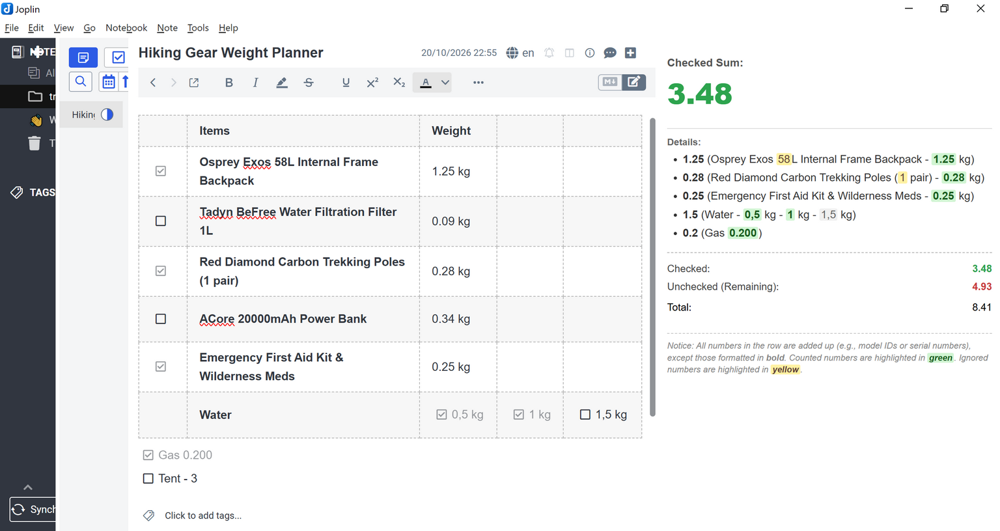
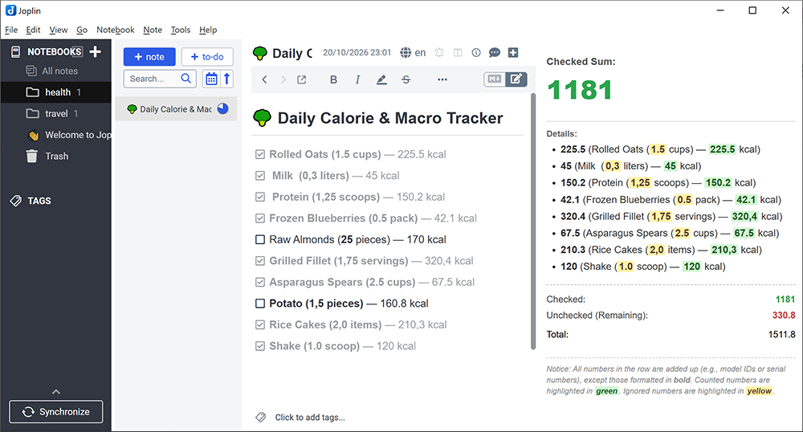

<div align="center">
  <h1>Joplin Checkbox Sum Calculator Plugin</h1>
  <p>
  <i>This is a plugin for <a href="https://github.com/laurent22/joplin">Joplin</a>. Refer to <a href="https://github.com/laurent22/joplin/tree/dev/packages/app-cli/tests/support/plugins/toc/">joplin toc</a>.</i>
  </p>
  <p>
    
    
    
    
    
  </p>
  <hr>
</div>

Sidebar utility for Joplin that automatically scans your active note for **Markdown checklists** and **HTML tables containing checkboxes**, summing up all numerical values in real-time. It splits metrics intelligently into Checked, Unchecked (Remaining), and Grand Total counters, providing detailed breakdowns.



The **Joplin Checkbox Sum Calculator** dynamically bridges text-editing with structured numerical workflows. Whenever you open or edit a note, the plugin sequentially tracks down your list tasks or table cells, runs an inline string parser to extract integers and decimals, handles localization formatting (supporting both dots `.` and commas `,` for decimals), and aggregates values cleanly inside your UI side pane.



## Use Cases & Examples

Here are 5 practical ways to automate your workflows using the **Checkbox Sum Calculator**:

* 🛒 **Smart Shopping Lists & Budget Estimators:** Build dynamic tables for your upcoming purchases. Bold text parameters like screen sizes (`**4K**`) or version tags (`**v12**`) to bypass calculation, and check items to instantly calculate the total cost of your active cart.
* 🥦 **Daily Calorie & Macro Tracker:** Keep a food journal directly in your notes. Use decimal values (e.g., `1.5` servings or `0,5` packs) to precisely count calories, protein, or carbs as you check off what you eat throughout the day.
* 💻 **Freelance Billing & Time Tracking:** List completed tasks with hours spent (e.g., `4.5` hours). Toggle checkboxes as tasks get approved to see the cumulative billable hours or invoice totals in real-time.
* 📉 **Savings Progress & Debt Paydown:** Set financial milestones (e.g., *Save from October bonus — 500*). Check off milestones as you deposit money, letting the sidebar track your exact total savings progress.
* 🗻 **Hiking Gear Weight Planner:** Track every gram before a big trip. List your equipment with individual weights (`0.3` kg or `450` g). As you physically pack items into your backpack and check them, the panel updates the current total weight of your gear.


## Examples & Rules

The calculator follows strict processing protocols based on structural markdown and layout formats to ensure calculations remain robust and predictable:

### 1. Standard Markdown Checklists
* **Counted Values:** Ordinary whole or fractional numbers contained anywhere along a standard bullet list line (e.g., `- [x] Oats — 225.5 kcal`) are parsed completely.
* **Checked vs. Unchecked:** Checked tasks (`- [x]`) map directly into the **Checked** sum bucket. Empty checklist items (`- [ ]`) map directly to **Unchecked (Remaining)**.

### 2. Advanced HTML Tables
Tables apply an automated structural analysis matrix tailored for tabular accounting:
* **Single Checkbox Row Profile:** If a row contains **exactly one** checkbox (either filled or empty), the state of that single checkbox dictates the mathematical fate of the entire row. If marked checked, *all* regular numeric cell tokens across the entire horizontal row add up into **Checked**.
* **Multi-Checkbox Row Profile:** If a row contains **more than one** distinct checkbox cell, the plugin flips into a hyper-granular **cell-by-cell matrix layout mode**. Numbers are summed into **Checked** strictly within cells where the checkbox is marked active. Cells holding unselected checkboxes, text strings, or no checkboxes at all flow into **Unchecked**.

### 3. Smart Bold Number Isolation Rule
* If any number is formatted inside **bold text** (`**number**` or `__number__`) or placed inside a bold cell (`<b>`, `<strong>`), the engine marks it as a system metadata bypass token. 
* It highlights the value in **yellow** inside the list views and **completely excludes it from all calculations**. This allows you to list sizes, years, model iterations, or dimensions (e.g., `MacBook Pro **15-inch** — 650`) without breaking your monetary or calorie math.


## Installation

### Method 1: Directly via the Joplin App (Recommended)
1. Launch **Joplin** on your desktop.
2. Navigate to your global configuration window: `Tools` > `Options` (or `Joplin` > `Preferences` on macOS).
3. Select the **Plugins** segment tab from the sidebar interface.
4. Type **`Checkbox Sum`** directly inside the search inputs field bar.
5. Click **Install**, then gently restart the Joplin application bootstrap to activate the panel layout.

### Method 2: Manual JPL Installation via Local Repository Releases
1. Navigate to the release dashboard on the official **GitHub Repository**.
2. Download the latest compiled production binary file archive bundle: **`joplin-plugin-checkbox-sum.jpl`** from the assets tab.
3. Open Joplin's `Tools` > `Options` > `Plugins` panel menu.
4. Click the gear icon tool dropdown overlay located near the top and choose **"Install from file"**.
5. Select the downloaded `.jpl` binary, import it, and restart Joplin.


## Getting Started

Once initialized, using the plugin is immediate and seamlessly embedded inside your native layout flows:

1. Look up at your primary top toolbar cluster. Click the newly added **Square Checklist Plus (`+` inside a box)** toggle button.
2. The calculator's native sidebar view pane will instantly anchor onto the right side edge layout.
3. Open any note containing checklists or financial spreadsheets. The plugin immediately flushes real-time metrics onto your screen:
   * **Checked Sum:** Large aesthetic display reflecting completed values.
   * **Details List:** A chronological text mirror highlighting matching lines, coloring items in **green** (counted) or **yellow** (ignored bold tokens).
   * **Analytics Summary Matrix:** A flat statistical breakdown detailing your exact *Checked*, *Unchecked (Remaining)*, and *Total* calculations.
4. **Infinite Height Support:** If your logs grow long (e.g., tracking a full year of savings or an intensive grocery receipt spreadsheet), the pane features an integrated vertical scroll container (`overflow-y: auto`) ensuring smooth scrolling access without breaking your UI.

## Development

```bash
# Install dependencies
npm install

# Build
npm run dist

# Watch mode
npm run dev
```

The built plugin is output to the `publish/` directory. To test locally, set `plugins.devPluginPaths` in Joplin's settings to point to the `publish/` directory.

## License

This repository is distributed under the terms of the **MIT License**. You are free to copy, modify, distribute, or use this extension setup commercially, provided the original author credits remain intact. See the `LICENSE` file for details.

<div align="center">

## Support the Project

If this plugin saves you time and helps you keep track of your calculations, consider supporting its further development! Any contribution is highly appreciated.

💵 **USDT (TRC-20):** `TS1x5AR87CipqAqF3bb7sqePBKqRLFEc4Q`

🪙 **Bitcoin (BTC):** `bc1qpamcvn5le907jkt5zhhd4c2r783489nts72m8m`

💎 **Ethereum (ETH):** `0x354dc4b9cEC4fC05021Cd26734B8cc839390e5af`

</div>

